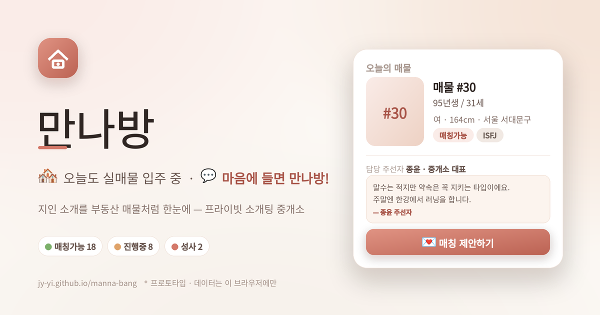

# 🏠 만나방 <sub>Manna-bang</sub>

> **지인 소개로만 이어지는 프라이빗 소개팅 중개소.**
> 카톡 단톡방에 묻히는 소개팅 프로필을, 부동산 매물장처럼 한눈에 보고 관리합니다.

**라이브 데모** · <https://jy-yi.github.io/manna-bang/>



---

## 프로젝트 소개

지인 소개로 소개팅을 주선하다 보면 프로필이 단톡방 위로 밀려 올라가고, 누가 누구에게 제안했는지, 어디까지 진행됐는지가 금방 흩어집니다. **만나방**은 그 흐름을 부동산 중개 앱의 문법으로 옮긴 웹앱입니다.

- 소개팅 대상자를 **매물**, 프로필을 올린 사람을 **주선자**로 두고 매물 번호(`매물 #07`)로 관리합니다. 이름 대신 번호를 쓰기 때문에 개인정보 노출이 줄어듭니다.
- 매물 카드에는 필수 스펙(성별·나이·키·거주지·근무지·직업)과 사진, 흡연·음주, MBTI, **💘 바라는 조건**이 한 화면에 정리됩니다.
- 주선자끼리 **매칭 제안**을 보내고, **매칭 현황판**에서 단계(제안중 → 일정 조율 → 만남 완료 → 애프터 → 성사 / 패스)를 넘기며 진행 상황을 공유합니다.
- 매칭 단위로 **마담 리뷰**를 남겨, 다음 소개에 참고할 후기를 쌓습니다. (공개 / 나만 보기)

> 현재 저장소의 버전은 **프론트엔드 단일 파일 프로토타입**입니다.
> 서버·DB 없이 브라우저 `localStorage`에만 저장되고, 등록된 샘플 데이터는 화면과 흐름을 확인하기 위한 **예시 데이터**입니다.

---

## 디자인 컨셉 — 🍑 피치 샴페인 & 아이보리

따뜻하고 차분한 톤으로, 소개팅 이야기를 다루는 화면이 가볍지 않게 보이도록 잡았습니다.

| 역할 | 토큰 | 값 |
| --- | --- | --- |
| 배경 | `--bg` / `--bg-2` | `#FCF9F5` / `#F7F1EB` |
| 카드 | `--card` | `#FFFFFF` |
| 본문 글자 | `--ink` / `--ink-2` / `--muted` | `#2F2623` / `#6A5750` / `#85716A` |
| 선 | `--line` / `--line-2` | `#EFE2DA` / `#E4D2C6` |
| 메인(피치) | `--coral` / `--coral-2` / `--coral-soft` | `#BC6354` / `#DE9B8C` / `#FAECE8` |
| 포인트(살구) | `--mint` / `--mint-2` / `--mint-soft` / `--mint-ink` | `#D4796A` / `#E09383` / `#FAECE8` / `#A9564A` |
| 진행중 | `--amber` / `--amber-soft` | `#DFA36A` / `#FDF1E6` |
| 리뷰·MBTI | `--violet` / `--violet-soft` | `#A98BC9` / `#F5EFFA` |

- 모서리: `--r-lg: 22px` · `--r-md: 16px` · `--r-sm: 12px`
- 그림자: `--shadow-s`(카드) / `--shadow-m`(모달·게이트)
- 서체: **Pretendard Variable** (jsDelivr CDN, `font-display` 기본) → 없으면 시스템 한글 폰트로 폴백
- 상태 색: 🟢 매칭가능 / 🟡 진행중 / 💘 성사 / ⏸️ 보류, 손님 모드는 보라 계열로 구분
- `prefers-reduced-motion`에서는 애니메이션·전환을 모두 끕니다

> 참고: 토큰 이름 `--mint`는 초기 테마에서 남은 이름이고, 실제 값은 피치·코랄 계열입니다. 색을 바꿀 때는 이름 대신 값을 보고 판단하세요.

---

## 주요 구현 기능

### 🔐 입장 & 권한

- **실전 모드(기본)**: Supabase Auth로 실제 로그인합니다. 입장 화면에서 본인 이름(칩)을 고르고 **개인 비번**을 넣으면 `{id}@manna.local` 계정으로 인증됩니다. 로그인은 **1시간** 유지되고, 1시간이 지나면 자동 로그아웃됩니다. 비번은 **숫자 6~8자리**(Supabase Auth 최소 6자리)로 정합니다. 기존에 4~5자리로 정해 둔 비번도 그대로 로그인되며, 새로 만들거나 바꿀 때만 6자리 이상이 필요합니다.
- **손님 모드**: **손님 입장코드**로 들어가는 **읽기 전용** 모드. **탭을 닫으면 해제**되고, 현황판·등록·수정·삭제·리뷰가 모두 숨겨집니다. 서버에서도 매물·매칭은 RPC로 필요한 것만, 리뷰는 공개분만 내려갑니다.
- **방장 관리(⚙️)**: 종윤(`ag1`, `is_owner`) 계정에만 보입니다. 주선자 **비번 초기화·비활성·추가**가 가능하고, 모든 주선자는 헤더의 🔑 버튼으로 **내 비번**을 직접 바꿀 수 있습니다. 이 동작은 Edge Function `manna-admin`이 서버에서 권한을 다시 검사합니다.
- **샘플 모드**: 게이트 아래 '샘플 모드로 둘러보기'는 서버 없이 `localStorage`에만 저장되는 예전 방식입니다.
- **공유 링크**: `?item=p12` 형태로 들어오면 로그인 후 해당 매물 상세가 바로 열립니다.

### 🏘️ 매물 등록·조회

- **필수 스펙**: 성별 · 출생연도 · 키 · 거주지 · 근무지 · 직업. 출생연도는 입력 즉시 `94년생 / 33세`처럼 **한국나이** 힌트가 붙습니다.
- **선택 항목**: 직장, MBTI, 흡연/음주(O·X·미입력), 매력 태그, 비고(자유 메모), 주선자 코멘트, 라벨+값 형태의 **추가 항목**(학력·종교·취미 등 자유롭게 증감).
- **💘 바라는 조건**: 자주 쓰는 조건 칩(담배 X, 초혼, 키 175cm 이상 …)을 누르거나 직접 입력. 쉼표로 여러 개를 한 번에 넣을 수 있고, 중복은 자동으로 정리됩니다.
- **사진**: **1~5장 필수**. 올리면 긴 변 **900px · JPEG 품질 0.78**로 자동 압축해 저장합니다. 첫 장이 대표가 되고, 다른 사진은 "대표" 버튼으로 앞으로 옮길 수 있습니다. 카드 썸네일 → 상세 슬라이드 → **라이트박스**(크게 보기)까지 이어집니다.
- **📥 사진 저장 / 📤 공유**: 주선자 전용. 저장은 `만나방_매물07_1.jpg` 같은 파일명으로 내려받고, 공유는 파일 공유를 지원하는 브라우저에서 카톡·문자로 바로 보냅니다. 안 되면 저장으로 자동 대체합니다.
- 매물을 지우면 연결된 매칭도 함께 정리되고, 상대 매물은 진행중/성사에서 **매칭가능**으로 돌아갑니다. 삭제는 한 번 더 확인합니다.

### 🔍 검색 & 필터

- 통합 검색 한 칸에 **매물 번호 · 나이/출생연도 · 직업 · 거주지 · 근무지 · MBTI · 태그 · 바라는 조건 · 담당 주선자**를 모두 담았습니다. `93년생`, `1993`, `34`, `34세` 어느 표기로도 찾힙니다.
- 필터: 상태 칩(전체/🟢/🟡/💘/⏸️), 성별, 나이(출생연도 구간 또는 직접 범위), 키(160·165·170·175·180 이상 또는 범위), 담당 주선자, **내 매물만** 토글.
- 정렬: 최신 등록순(기본) · 오래된 등록순 · 나이 어린 순 · 나이 많은 순.
- 결과 줄에 현재 적용 조건이 요약되고, `필터 초기화` 버튼이 함께 나옵니다.

### 💌 매칭 현황판

- 매물 상세에서 **💌 매칭 제안** → 상대 성별의 매물 중 하나를 고르면 매칭이 만들어지고, 두 매물이 **🟡 진행중**으로 바뀌며 현황판으로 이동합니다. 방금 만든 카드는 맨 위에서 잠시 강조됩니다.
- 카드마다 **보낸 쪽 / 받은 쪽**과 담당 주선자가 표시되고, 단계 스텝(5단)과 단계 버튼이 붙습니다. `제안중` 카드에는 **✅ 수락 · 일정 조율 / ✕ 패스** 한 줄 액션이 크게 나옵니다.
- 필터 칩: `전체` · `👤 내 매물` · `📩 내게 온 제안` · `📤 내가 보낸 제안`. 내 매물에 들어온 제안 수는 **탭 배지**로 표시됩니다.
- **마담 리뷰**: 매칭 상대 매물의 담당 주선자만 쓸 수 있는 후기. `🌐 마담 공개`(주선자 전원) 또는 `🔒 나만 보기`(작성자만)를 고르고, 나중에 공개 범위를 바꾸거나 삭제할 수 있습니다. 손님에게는 전부 비노출입니다.

### 🏆 주선자 랭킹 & 활동 점수

- **활동 점수 = 성사 × 10 + 진행 × 3 + 보유 × 1**
- 점수 → 성사 → 진행 → 보유 순으로 정렬하고, 1~3위는 🥇🥈🥉로 표시합니다. 내 줄은 강조됩니다.
- 주선자마다 헤더에서 **내 이모지**를 고를 수 있고(추천 20종 + 직접 입력), 이모지는 입장 칩·카드·현황판·랭킹에 함께 반영됩니다.

### 📱 모바일 UX

- **모달 뒤로가기**: 상세·등록/수정·이모지 팝업·완료 팝업·라이트박스는 `history.pushState` / `popstate`로 엔트리를 쌓아, 휴대폰 뒤로가기가 **사이트를 벗어나지 않고 모달만** 닫습니다. X·딤 클릭으로 닫을 때는 엔트리를 함께 정리해 뒤로가기를 두 번 눌러야 하는 일이 없습니다.
- **손가락 스와이프**: 상세 갤러리와 라이트박스에서 좌우로 넘깁니다. 가로 이동이 40px 이상이고 세로보다 클 때만 사진이 넘어가, 세로 스크롤과 충돌하지 않습니다.
- **신규 매물 등록 완료 팝업**: 등록을 마치면 **카톡 단톡방 알림 문구**가 자동으로 만들어집니다. `💬 카톡 단톡방에 알리기`(공유) 또는 `📋 알림 문구 복사`로 바로 알릴 수 있습니다.
- 375px 기준으로 카드·현황판·모달 레이아웃을 맞췄고, 340px 이하 구간은 한 줄에 뱃지와 주선자 이름이 잘리지 않도록 글자를 한 단계 더 줄입니다.

---

## 기술 스택 & 향후 계획

| 구분 | 현재 |
| --- | --- |
| 프론트엔드 | **Vanilla HTML + CSS + JavaScript** (빌드 없음, `index.html` + `cloud.js`) |
| 호스팅 | **GitHub Pages** (`main` 브랜치 루트) |
| 데이터 | **Supabase Postgres** (`manna_state` RPC로 조회) + 샘플 모드는 `localStorage` |
| 인증 | **Supabase Auth** (이메일/비번 매핑) + DB RLS + `security definer` RPC |
| 사진 | **비공개 Storage 버킷** `manna-photos` + 서명 URL(2시간) |
| 공유 | Web Share API / 클립보드 / `?item=` 딥링크 |
| 알림 | 등록 완료 시 공유 문구 팝업 |

**향후 계획**

1. 매칭 `수락` 시 `검토중` 단계를 둘지 결정 (지금은 바로 `일정 조율`)
2. 여러 명이 동시에 쓰기 시작하면 Supabase Realtime 반영
3. 데이터 내보내기(JSON/CSV)

**실전 모드 켜는 순서** (최초 1회)

1. Supabase SQL Editor에서 `schema.sql` 실행 (서버 정의 파일은 공개 저장소에 두지 않고 별도 보관)
2. `supabase functions deploy manna-admin --no-verify-jwt`
3. 사이트 주소에 `?setup=1`을 붙여 접속(예: `https://jy-yi.github.io/manna-bang/?setup=1`) → 게이트 아래 **🛠 처음 계정 만들기 (방장)** → 주선자 초기 비번·손님 입장코드(숫자 6~8자리) 입력
4. 종윤으로 입장 → ⚙️ 방장 관리에서 각자 비번 초기화 후 전달

> **🛠 처음 계정 만들기** 버튼은 평소 게이트에 보이지 않습니다. `?setup=1`로 열었을 때만 나타나고, 이미 계정이 있으면 서버(`manna-admin`의 `already_bootstrapped`)가 막습니다.

---

## 파일 구성

```
manna-bang/
├── index.html          # 앱 화면·로직 (마크업 + CSS + JavaScript)
├── cloud.js            # Supabase 연동 계층 (로그인·조회·쓰기·사진·방장)
├── vendor/
│   └── supabase-js-2.119.1.min.js   # supabase-js v2 고정본
├── og-image.png        # 공유 썸네일 1200×630
├── icon-512.png        # 앱 아이콘 512×512
├── apple-touch-icon.png# iOS 홈 화면 아이콘 180×180
├── README.md           # 이 문서
└── HANDOFF.md          # 코드 구조·수정 가이드 (다른 AI/개발자 인수인계용)
```

빌드는 필요 없습니다. 외부 의존은 Pretendard 폰트 CDN과 Supabase 하나뿐입니다.

## 로컬 실행

빌드도, 패키지 설치도 필요 없습니다.

```bash
git clone https://github.com/jy-yi/manna-bang.git
cd manna-bang
python3 -m http.server 8000
# 브라우저에서 http://localhost:8000 접속
```

`index.html`을 파일로 바로 열어도 대부분 동작하지만, 사진 저장·공유와 클립보드는 `http(s)` 환경에서 더 안정적입니다.

데모 데이터를 처음 상태로 되돌리려면 화면 하단의 **데모 데이터 초기화**를 누르세요.

## 데이터·개인정보에 대해

- 이 저장소는 **공개 저장소**입니다. 샘플 모드의 데이터는 브라우저에만 저장되고 서버로 나가지 않습니다.
- 실전 모드의 데이터는 **Supabase**(서울 리전 무료 프로젝트)에 저장되고, 사진은 **비공개 버킷**에 올라가 로그인한 사용자만 서명 URL로 볼 수 있습니다.
- 저장소에는 publishable(anon) 키만 있습니다. **service_role 키는 어디에도 넣지 않습니다.**
- 화면의 예시 데이터는 흐름 확인용입니다. 실제 지인의 개인정보(실명·연락처·상세 주소·실제 사진)를 이 저장소에 올리지 마세요.
- 자세한 구조와 수정 방법은 [HANDOFF.md](HANDOFF.md)를 보세요.

---

<sub>🏘️ 오늘도 실매물 입주 중 · 💬 마음에 들면 만나방!</sub>
